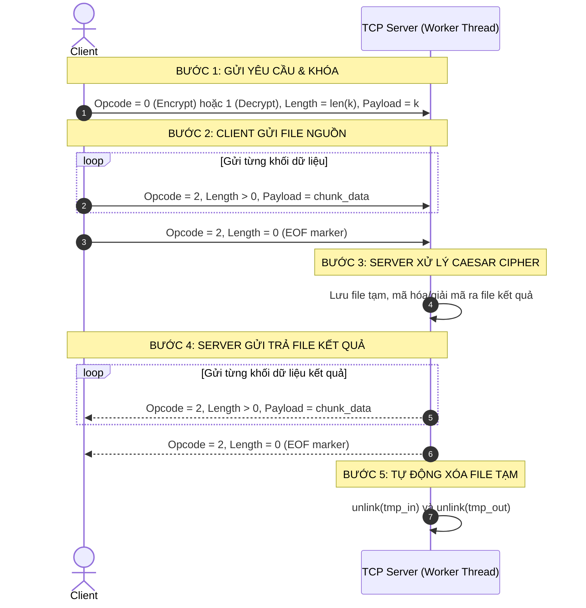

# IT4062 – BÀI TẬP TUẦN 6 (THỰC HÀNH LẬP TRÌNH MẠNG)
## THƯ MỤC NỘP BÀI: `Week_7`

- **Sinh viên:** Do Xuan Quy
- **MSSV:** 20235818
- **Môi trường chạy:** WSL (Kali Linux) / GCC (C11, POSIX-compliant, `pthread`)
- **Tên file nén nộp bài:** `DoXuanQuy_20235818_HW6.zip`
- **Nội dung:**
  - **Bài 1:** Ứng dụng Mã hóa / Giải mã file Caesar Cipher qua TCP Socket và Kỹ thuật Đa luồng (`pthread`), giao thức nhị phân chuẩn (Opcode 1B, Length 2B, Payload), thư mục dùng chung lưu file tạm và tự động dọn dẹp.
  - **Bài 2:** Ứng dụng Quản lý Đăng nhập / Đăng xuất qua TCP Socket và Kỹ thuật Đa tiến trình (`fork()`), đồng bộ bộ nhớ chia sẻ (`mmap` MAP_SHARED), bắt tín hiệu `SIGCHLD` triệt tiêu hoàn toàn zombie process, tự động khóa tài khoản khi nhập sai quá 3 lần và ghi đè bền vững vào `account.txt`.

---

## 1. Cấu trúc thư mục (`Week_7/`)

```
Week_7/
├── Makefile                # Makefile chung (biên dịch bai1, bai2, clean, distclean, đóng gói zip)
├── README.md               # Sổ tay toàn diện hướng dẫn từng lệnh terminal chạy thủ công mọi test case
├── bai1/                   # BÀI 1: Caesar Cipher (TCP Socket + Multithreading pthread)
│   ├── Makefile            # Makefile riêng của Bài 1 (sinh ra file thực thi 'server' và 'client')
│   ├── protocol.h          # Định nghĩa khuôn dạng thông điệp (Opcode, Length, Payload)
│   ├── server.c            # Source TCP Server đa luồng, xử lý Caesar và quản lý file tạm
│   ├── client.c            # Source TCP Client, menu lựa chọn mã hóa/giải mã, upload/download
│   └── storage/            # Thư mục lưu file tạm trên server (tự động tạo và dọn sạch)
└── bai2/                   # BÀI 2: User Authentication (TCP Socket + Multiprocess fork)
    ├── Makefile            # Makefile riêng của Bài 2 (sinh ra file thực thi 'server' và 'client')
    ├── server.c            # Source TCP Server đa tiến trình dùng fork(), mmap shared, sigchld
    ├── client.c            # Source TCP Client tương tác đăng nhập/đăng xuất
    └── account.txt         # Dữ liệu tài khoản mẫu (UserID Password Status)
```

---

## 2. Hướng dẫn sử dụng Makefile & Kiểm tra file nén nộp bài

Tại thư mục gốc `Week_7/`, toàn bộ thao tác quản lý dự án được thực hiện thông qua Makefile chuẩn mực:

| Lệnh Makefile | Tác dụng chi tiết |
|---|---|
| `make` hoặc `make all` | Biên dịch toàn bộ cả `bai1` và `bai2`, tạo ra các file thực thi chuẩn `server` và `client` ở cả hai thư mục con |
| `make clean` | Dọn dẹp tất cả các file thực thi, file đối tượng (`*.o`), file tạm (`*.tmp`), file kết quả sinh ra trong quá trình test |
| `make distclean` | Dọn dẹp sạch sẽ như `clean`, đồng thời xóa thư mục lưu trữ `bai1/storage/` |
| `make package` (hoặc `make zip`) | Tự động chạy `clean`, sau đó đóng gói **CHỈ CÁC FILE MÃ NGUỒN VÀ MAKEFILE** vào file nén **`DoXuanQuy_20235818_HW6.zip`** |

### Lệnh đóng gói và kiểm tra nội dung file nộp bài:
```bash
make package
unzip -l DoXuanQuy_20235818_HW6.zip
```

Kết quả hiển thị trên terminal:
```text
Archive:  DoXuanQuy_20235818_HW6.zip
  Length      Date    Time    Name
---------  ---------- -----   ----
     1522  2026-10-28 12:00   Makefile
      860  2026-10-28 12:00   bai1/Makefile
      680  2026-10-28 12:00   bai1/protocol.h
     9850  2026-10-28 12:00   bai1/server.c
     7920  2026-10-28 12:00   bai1/client.c
      780  2026-10-28 12:00   bai2/Makefile
    12450  2026-10-28 12:00   bai2/server.c
     6420  2026-10-28 12:00   bai2/client.c
       81  2026-10-28 12:00   bai2/account.txt
---------                     -------
    40563                     9 files
```
*(Đúng tuyệt đối quy định: Đúng tên file `DoXuanQuy_20235818_HW6.zip`, chỉ gồm 9 tệp tin mã nguồn, Makefile và file tài khoản mẫu ban đầu; không chứa file `.o`, file nhị phân, file `.md` hay dữ liệu rác).*

---

## 3. Hướng dẫn chuẩn bị và tùy biến dữ liệu kiểm thử (Custom Input Files)

Hệ thống được thiết kế mở hoàn toàn, **bạn có toàn quyền chuẩn bị và sử dụng bất kỳ file dữ liệu nào của bạn** để kiểm thử trên WSL Kali Linux:

### 3.1. Chuẩn bị file dữ liệu kiểm thử Bài 1 (Caesar Cipher)
Bạn có thể dùng bất kỳ file văn bản nào có sẵn hoặc tự tạo nhanh file văn bản bằng lệnh terminal:
- Tạo file text đơn giản có chữ hoa, chữ thường, số và dấu câu:
  ```bash
  echo "Attack at dawn! XYZ abc 123" > ~/test_plain.txt
  ```
- Tạo file văn bản lớn (nhiều dòng, dung lượng vài chục đến vài trăm KB) để kiểm tra truyền phân mảnh (chunking):
  ```bash
  cat /etc/services > ~/large_plain.txt
  ```
- File kết quả sau khi mã hóa/giải mã sẽ được lưu vào đường dẫn do bạn tự chỉ định (ví dụ: `cipher.txt`, `restored.txt`).

### 3.2. Chuẩn bị file dữ liệu tài khoản (`account.txt`) cho Bài 2
Định dạng mỗi dòng trong `account.txt`:
```text
UserID Password Status
```
- `UserID`: Tên tài khoản (không chứa khoảng trắng).
- `Password`: Mật khẩu tài khoản.
- `Status`: `1` là tài khoản hoạt động, `0` là tài khoản bị khóa.

**Khởi tạo lại file test mẫu ban đầu bất kỳ lúc nào bằng lệnh terminal:**
```bash
cat << 'EOF' > /mnt/d/HUST_Study/2026.1/TH_lap_trinh_mang/Do_Xuan_Quy_20235818/TH_Lap_trinh_mang/Week_7/bai2/account.txt
admin 123456 1
user1 pass1 1
user2 pass2 0
quydx secret2023 1
student 20235818 1
EOF
```
- Bạn có thể chỉnh sửa tự do bằng `nano bai2/account.txt` hoặc copy file từ nơi khác vào.
- Server xử lý an toàn: bỏ qua dòng trắng, tự động chuẩn hóa ký tự xuống dòng Windows (`\r\n`) và Linux (`\n`).

---

## 4. Kiến trúc và Logic Hệ thống

### 4.1. Bài 1: Giao thức Caesar Cipher qua TCP Socket Đa luồng (`pthread`)

1. **Khuôn dạng thông điệp (Message Framing):**
   ```text
   +----------------+------------------+---------------------------+
   | Opcode (1B)    | Length (2B, BE)  | Payload (0 - 2048 bytes)  |
   +----------------+------------------+---------------------------+
   ```
   - `Opcode = 0`: Yêu cầu Mã hóa (Payload chứa chuỗi giá trị khóa `k`).
   - `Opcode = 1`: Yêu cầu Giải mã (Payload chứa chuỗi giá trị khóa `k`).
   - `Opcode = 2`: Truyền khối dữ liệu file. Khi `Length > 0`, Payload chứa dữ liệu file; khi `Length == 0`, báo hiệu đã truyền xong toàn bộ file (EOF marker).
   - `Opcode = 3`: Báo lỗi (`Length = 0`, không mang payload).

2. **Quy trình hoạt động 5 bước:**
   - **B1:** Client gửi gói tin yêu cầu (Opcode = 0 hoặc 1, Length = len(key), Payload = key).
   - **B2:** Client chia file nguồn thành từng khối (tối đa 2048 bytes), gửi liên tiếp các gói (Opcode = 2, Length = chunk_len). Cuối cùng gửi gói (Opcode = 2, Length = 0) báo kết thúc.
   - **B3:** Server ghi dữ liệu nhận được vào file tạm `storage/tmp_in_<tid>_<fd>.dat`. Thực hiện thuật toán Caesar Cipher với khóa `k`, sinh ra file kết quả `storage/tmp_out_<tid>_<fd>.dat`. Nếu có lỗi, Server gửi lại gói (Opcode = 3, Length = 0).
   - **B4:** Server đọc file kết quả, gửi trả về Client qua các gói (Opcode = 2, Length = chunk_len), kết thúc bằng gói (Opcode = 2, Length = 0).
   - **B5:** Server đóng socket và tự động gọi `unlink()` xóa sạch cả 2 file tạm trên đĩa.



3. **Thuật toán Caesar Cipher:**
   - Khóa $k$ được chuẩn hóa: `norm_k = (k % 26 + 26) % 26`.
   - Đối với chữ thường: `c' = (c - 'a' + norm_k) % 26 + 'a'` (khi giải mã, thay `norm_k` bằng `(26 - norm_k) % 26`).
   - Đối với chữ hoa: `c' = (c - 'A' + norm_k) % 26 + 'A'`.
   - Các ký tự khác (số, dấu câu, khoảng trắng, dấu xuống dòng) được giữ nguyên vẹn 100%.

4. **Đa luồng & Cô lập file tạm:**
   - Mỗi client kết nối được tạo một luồng riêng (`pthread_create()` + `pthread_detach()`).
   - Tên file tạm được đặt duy nhất dựa trên Thread ID và Socket FD (`storage/tmp_in_<tid>_<fd>.dat`), loại trừ hoàn toàn khả năng xung đột ghi đè file kể cả khi nhiều client gửi file trùng tên cùng lúc.

---

### 4.2. Bài 2: Quản lý Đăng nhập qua TCP Socket Đa tiến trình (`fork()`)

1. **Mô hình Đa tiến trình (`fork()`):**
   - Khi có kết nối mới, Server gọi `fork()` sinh ra tiến trình con phục vụ riêng client đó.
   - Tiến trình cha lập tức đóng `client_fd` và chờ kết nối tiếp theo.
   - Tiến trình con đóng `server_fd`, thực hiện chu trình phục vụ, khi client ngắt kết nối thì tiến trình con gọi `exit(0)`.
2. **Triệt tiêu hoàn toàn Zombie Process:**
   - Đăng ký hàm xử lý `SIGCHLD` với cờ `SA_RESTART | SA_NOCLDSTOP`:
     ```c
     static void sigchld_handler(int sig) {
         (void)sig;
         while (waitpid(-1, NULL, WNOHANG) > 0);
     }
     ```
   - Bất cứ khi nào tiến trình con kết thúc, tiến trình cha sẽ tự động thu dọn bảng trạng thái ngay lập tức, không để lại tiến trình `<defunct>`.
3. **Đồng bộ dữ liệu liên tiến trình (IPC Shared Memory & Mutex):**
   - Cấp phát vùng nhớ chia sẻ bằng `mmap` với cờ `MAP_SHARED | MAP_ANONYMOUS` trước khi `fork()`.
   - Khởi tạo Mutex với thuộc tính `PTHREAD_PROCESS_SHARED`:
     ```c
     pthread_mutexattr_setpshared(&mattr, PTHREAD_PROCESS_SHARED);
     ```
   - Khi tiến trình con A tăng số lần sai của một tài khoản hoặc chuyển `Status = 0`, tiến trình con B ở cửa sổ khác thấy sự thay đổi ngay lập tức trong RAM.
   - Đồng thời, tiến trình con thực hiện ghi đè bền vững (Atomic File Write) vào `account.txt` trên ổ đĩa.

---

## 5. HƯỚNG DẪN KIỂM THỬ THỦ CÔNG BÀI 1 (CAESAR CIPHER QUA TCP ĐA LUỒNG)

Toàn bộ các ca kiểm thử dưới đây được thực hiện **thủ công bằng từng lệnh gõ trực tiếp trên Terminal WSL Kali Linux**.

### 5.1. Khởi động môi trường kiểm thử Bài 1

Mở **Terminal 1 (Server)**:
```bash
# 1. Điều hướng vào thư mục bài 1
cd /mnt/d/HUST_Study/2026.1/TH_lap_trinh_mang/Do_Xuan_Quy_20235818/TH_Lap_trinh_mang/Week_7/bai1

# 2. Dọn dẹp và biên dịch
make clean && make

# 3. Khởi động Server ở cổng 5500
./server 5500
```
Server sẽ in ra:
```text
====================================================
[*] Caesar Cipher TCP Server listening on port 5500...
[*] Multithreaded model active (POSIX pthread).
[*] Shared temporary directory: ./storage/
====================================================
```

Mở **Terminal 2 (Client)**:
```bash
cd /mnt/d/HUST_Study/2026.1/TH_lap_trinh_mang/Do_Xuan_Quy_20235818/TH_Lap_trinh_mang/Week_7/bai1
```

---

### 5.2. Danh sách các ca kiểm thử thủ công chi tiết Bài 1

#### TEST 1.1: Kiểm tra tính hợp lệ của tham số dòng lệnh (Command-line Arguments)
Tại **Terminal 2**, chạy lần lượt từng lệnh sau:

| Lệnh gõ trên Terminal | Kết quả in ra màn hình | Giải thích |
|---|---|---|
| `./server` | `Usage: ./server <Port_Number>` | Báo lỗi thiếu tham số cổng |
| `./server 70000` | `Error: Invalid port number '70000'. Must be between 1025 and 65535.` | Báo lỗi cổng vượt quá 65535 |
| `./server abc` | `Error: Invalid port number 'abc'.` | Báo lỗi cổng không phải số |
| `./client` | `Usage: ./client <IP_Addr> <Port_Number> ...` | Báo lỗi thiếu cả IP và Port |
| `./client 127.0.0.1` | `Usage: ./client <IP_Addr> <Port_Number> ...` | Báo lỗi thiếu Port |
| `./client 999.1.1.1 5500` | `Error: Invalid IPv4 address '999.1.1.1'.` | Báo lỗi định dạng IPv4 không hợp lệ |
| `./client 127.0.0.1 5501` | `connect: Connection refused` | Báo lỗi từ chối kết nối do server chưa bật ở cổng 5501 |

---

#### TEST 1.2: Mã hóa file văn bản đơn giản (Khóa Caesar k = 3)
Tại **Terminal 2**:
1. Chuẩn bị file nguồn `plain.txt`:
   ```bash
   echo "Attack at dawn! XYZ abc 123" > plain.txt
   cat plain.txt
   ```
2. Khởi động Client ở chế độ tương tác:
   ```bash
   ./client 127.0.0.1 5500
   ```
   Màn hình Client hiển thị:
   ```text
   =========================================
        CAESAR CIPHER TCP CLIENT (BAI 1)    
   =========================================
    1. Encrypt a file (Mã hóa file)
    2. Decrypt a file (Giải mã file)
    3. Exit
   -----------------------------------------
   Select option [1-3]:
   ```
3. Nhập lần lượt các thông tin:
   - Gõ `1` rồi nhấn `Enter` (Chọn Encrypt).
   - `Enter Caesar key (integer, e.g. 3): ` -> Gõ `3` rồi nhấn `Enter`.
   - `Enter input file path: ` -> Gõ `plain.txt` rồi nhấn `Enter`.
   - `Enter output destination file path: ` -> Gõ `cipher.txt` rồi nhấn `Enter`.
4. **Kết quả hiển thị trên Client:**
   ```text
   [*] Sending ENCRYPTION request with key 3...
   [*] Uploading input file 'plain.txt'...
   [*] Sent 28 bytes. Waiting for server result...
   [SUCCESS] File processed successfully! Saved as: 'cipher.txt' (28 bytes)
   ```
5. **Kiểm tra nội dung bản mã:**
   Mở terminal xem file `cipher.txt`:
   ```bash
   cat cipher.txt
   ```
   **Kết quả in ra đúng chuẩn Caesar:**
   ```text
   Dwwdfn dw gdzq! ABC def 123
   ```
   *(Chữ hoa: `A` -> `D`, `X` -> `A`, `Y` -> `B`, `Z` -> `C`; Chữ thường: `a` -> `d`, `b` -> `e`, `c` -> `f`; Dấu cách, dấu chấm than `!`, số `123` giữ nguyên).*

> **Mẹo chạy nhanh Test 1.2 bằng 1 dòng lệnh duy nhất (Direct CLI Mode):**
> ```bash
> ./client 127.0.0.1 5500 encrypt 3 plain.txt cipher.txt
> ```

---

#### TEST 1.3: Giải mã file đã mã hóa (Khóa k = 3 -> Khôi phục nguyên vẹn)
Tại **Terminal 2**:
1. Thực hiện giải mã file `cipher.txt` vừa tạo ở Test 1.2 về lại `restored.txt`:
   ```bash
   ./client 127.0.0.1 5500 decrypt 3 cipher.txt restored.txt
   ```
2. **Kết quả hiển thị:**
   ```text
   [*] Sending DECRYPTION request with key 3...
   [*] Uploading input file 'cipher.txt'...
   [*] Sent 28 bytes. Waiting for server result...
   [SUCCESS] File processed successfully! Saved as: 'restored.txt' (28 bytes)
   ```
3. **Kiểm tra tính trùng khớp 100% bằng lệnh `diff` của Linux:**
   ```bash
   diff plain.txt restored.txt
   ```
   *Lệnh không xuất ra bất kỳ sự khác biệt nào -> Bản rõ ban đầu được khôi phục nguyên vẹn từng ký tự.*

---

#### TEST 1.4: Thử nghiệm với các giá trị khóa đặc biệt (k = 0, k = 26, k = 29, k = -3)
Tại **Terminal 2**, kiểm tra khả năng chuẩn hóa khóa modulo 26 của thuật toán:

1. **Khóa $k = 0$ hoặc $k = 26$ (Dịch chuyển trọn vòng):**
   ```bash
   ./client 127.0.0.1 5500 encrypt 26 plain.txt cipher_k26.txt
   diff plain.txt cipher_k26.txt
   ```
   *(Kết quả: `diff` không có sự khác biệt, bản mã trùng bản rõ).*

2. **Khóa lớn $k = 29$ (Tương đương $29 \pmod{26} = 3$):**
   ```bash
   ./client 127.0.0.1 5500 encrypt 29 plain.txt cipher_k29.txt
   diff cipher.txt cipher_k29.txt
   ```
   *(Kết quả: `cipher_k29.txt` giống hệt `cipher.txt` với khóa $k=3$).*

3. **Khóa âm $k = -3$:**
   ```bash
   ./client 127.0.0.1 5500 encrypt -3 plain.txt cipher_neg3.txt
   cat cipher_neg3.txt
   ```
   *(Các ký tự dịch lùi 3 vị trí, ví dụ `D` lùi về `A`).*
   Giải mã với khóa `-3`:
   ```bash
   ./client 127.0.0.1 5500 decrypt -3 cipher_neg3.txt restored_neg3.txt
   diff plain.txt restored_neg3.txt
   ```
   *(Khôi phục chính xác 100%).*

---

#### TEST 1.5: Mã hóa và Giải mã file lớn (> 100 KB, kiểm tra phân mảnh gói tin)
Tại **Terminal 2**:
1. Sinh file văn bản lớn từ dữ liệu hệ thống Kali Linux:
   ```bash
   cat /etc/services > large_plain.txt
   ls -lh large_plain.txt
   ```
   *(Dung lượng file khoảng 600 - 700 KB, tương đương hơn 300 gói tin chunk).*
2. Tiến hành mã hóa file lớn với khóa $k = 7$:
   ```bash
   ./client 127.0.0.1 5500 encrypt 7 large_plain.txt large_cipher.txt
   ```
3. Tiến hành giải mã file lớn:
   ```bash
   ./client 127.0.0.1 5500 decrypt 7 large_cipher.txt large_restored.txt
   ```
4. So sánh kiểm tra bằng `cmp` và `sha256sum`:
   ```bash
   cmp large_plain.txt large_restored.txt && echo "FILE LON TRUNG KHOP 100%!"
   sha256sum large_plain.txt large_restored.txt
   ```
   *Hai chuỗi băm in ra hoàn toàn trùng khớp từng ký tự -> Cơ chế gửi nhận phân mảnh chunking hoạt động chuẩn xác.*

---

#### TEST 1.6: Xử lý lỗi khi file đầu vào không tồn tại
Tại **Terminal 2**, yêu cầu mã hóa một file không hề có trên máy:
```bash
./client 127.0.0.1 5500 encrypt 3 file_khong_ton_tai.xyz output.txt
```
**Kết quả hiển thị:**
```text
Error: Cannot open input file 'file_khong_ton_tai.xyz': No such file or directory
```
*(Client phát hiện lỗi ngay từ đĩa cục bộ, không gửi yêu cầu rác lên server).*

---

#### TEST 1.7: Kiểm tra đa luồng đồng thời & Cô lập file tạm trên Server
Để kiểm tra yêu cầu: *"Người dùng có thể gửi file có tên trùng nhau, file tạm trên server không bị trùng tên"*:

1. Mở đồng thời **Terminal 2** và **Terminal 3**.
2. Cả 2 terminal cùng chuẩn bị file có tên giống hệt nhau là `plain.txt` nhưng nội dung khác nhau:
   - Tại Terminal 2: `echo "Message from Client 1" > plain.txt`
   - Tại Terminal 3: `echo "Another secret from Client 2" > plain.txt`
3. Chạy lệnh mã hóa gần như đồng thời ở cả 2 terminal:
   - Terminal 2: `./client 127.0.0.1 5500 encrypt 3 plain.txt res1.txt`
   - Terminal 3: `./client 127.0.0.1 5500 encrypt 5 plain.txt res2.txt`
4. **Quan sát log tại Terminal 1 (Server):**
   Server in ra 2 Thread ID khác nhau xử lý 2 file tạm riêng biệt:
   ```text
   [+] [Thread 140234...] Client connected from 127.0.0.1:45120
   [*] [Thread 140234...] Request: ENCRYPT (Key: 3)
   [+] [Thread 140235...] Client connected from 127.0.0.1:45122
   [*] [Thread 140235...] Request: ENCRYPT (Key: 5)
   ```
5. **Kiểm tra thư mục `storage/` trên Server:**
   ```bash
   ls -la storage/
   ```
   *Thư mục `storage/` hoàn toàn sạch sẽ, không hề đọng lại bất kỳ file tạm nào vì Server đã tự động xóa sạch bằng `unlink()` theo đúng Bước 5 của đề bài.*

---

## 6. HƯỚNG DẪN KIỂM THỬ THỦ CÔNG BÀI 2 (TCP AUTHENTICATION QUA ĐA TIẾN TRÌNH `fork()`)

### 6.1. Khởi động môi trường kiểm thử Bài 2

Mở **Terminal 1 (Server Đa tiến trình)**:
```bash
# 1. Điều hướng vào thư mục bài 2
cd /mnt/d/HUST_Study/2026.1/TH_lap_trinh_mang/Do_Xuan_Quy_20235818/TH_Lap_trinh_mang/Week_7/bai2

# 2. Khôi phục dữ liệu tài khoản ban đầu
cat << 'EOF' > account.txt
admin 123456 1
user1 pass1 1
user2 pass2 0
quydx secret2023 1
student 20235818 1
EOF

# 3. Dọn dẹp và biên dịch
make clean && make

# 4. Khởi động Server ở cổng 5500
./server 5500
```
Server sẽ in ra:
```text
[*] Loaded 5 accounts from 'account.txt'.
====================================================
[*] TCP Authentication Server listening on port 5500...
[*] Multiprocess model active (fork() + shared memory).
====================================================
```

Mở **Terminal 2 (Client Cửa sổ 1)**:
```bash
cd /mnt/d/HUST_Study/2026.1/TH_lap_trinh_mang/Do_Xuan_Quy_20235818/TH_Lap_trinh_mang/Week_7/bai2
```

---

### 6.2. Danh sách các ca kiểm thử thủ công chi tiết Bài 2

#### TEST 2.1: Đăng nhập thành công, Kiểm tra trạng thái và Đăng xuất (Happy Path)
Tại **Terminal 2**, kết nối Client tới Server:
```bash
./client 127.0.0.1 5500
```
Màn hình hiển thị:
```text
[Server] 200 Welcome to Multiprocess TCP Authentication Server. Ready.

=========================================
     TCP USER AUTHENTICATION CLIENT     
=========================================
 1. Log in
 2. Log out
 3. Check current user status (WhoAmI)
 4. Exit
-----------------------------------------
Select option [1-4] or type command:
```

Thực hiện các thao tác:
1. Gõ `1`, nhập `quydx`, nhập `secret2023` -> Server báo:
   ```text
   [Server] 200 Login successful. Welcome, quydx!
   ```
2. Gõ `3` (WhoAmI) -> Server báo:
   ```text
   [Server] 200 Logged in as: quydx
   ```
3. Gõ `2` (Logout) -> Server báo:
   ```text
   [Server] 200 Logged out successfully.
   ```
4. Gõ `3` (Kiểm tra lại sau logout) -> Server báo: `[Server] 200 Not logged in.`
5. Thử gõ `2` (Logout khi chưa login) -> Server báo: `[Server] 400 You are not logged in.`

> **Cách chạy nhanh Test 2.1 bằng 1 dòng lệnh duy nhất:**
> ```bash
> printf "1\nquydx\nsecret2023\n3\n2\n3\n2\n4\n" | ./client 127.0.0.1 5500
> ```

---

#### TEST 2.2: [YÊU CẦU 1] Mỗi cửa sổ client chỉ đăng nhập 1 tài khoản
Tại **Terminal 2**:
```bash
./client 127.0.0.1 5500
```
1. Chọn `1`, đăng nhập `quydx` / `secret2023` -> Thành công.
2. Cố tình chọn tiếp `1` để đăng nhập tài khoản khác `user1` / `pass1`:
3. **Kết quả mong đợi:**
   ```text
   [Server] 401 Already logged in as 'quydx'. Please logout first.
   ```
   *(Server từ chối không cho phép đăng nhập đè khi chưa đăng xuất).*
4. Gõ `4` để thoát.

> **Cách chạy nhanh Test 2.2 bằng 1 dòng lệnh:**
> ```bash
> printf "1\nquydx\nsecret2023\n1\nuser1\npass1\n4\n" | ./client 127.0.0.1 5500
> ```

---

#### TEST 2.3: [YÊU CẦU 2] Một tài khoản có thể đăng nhập đồng thời trên nhiều cửa sổ
*Yêu cầu đề bài: Mỗi tài khoản có thể đăng nhập đồng thời trên nhiều cửa sổ.*

Mở đồng thời **3 cửa sổ Terminal**:
- **Terminal 1**: Đang chạy `./server 5500`.
- **Terminal 2 (Client 1)**:
  ```bash
  cd /mnt/d/HUST_Study/2026.1/TH_lap_trinh_mang/Do_Xuan_Quy_20235818/TH_Lap_trinh_mang/Week_7/bai2
  ./client 127.0.0.1 5500
  # Chọn 1 -> UserID: student -> Password: 20235818
  ```
  Kết quả in ra: `[Server] 200 Login successful. Welcome, student!`
  *(Giữ nguyên cửa sổ này, không đăng xuất).*
- **Terminal 3 (Client 2)**:
  ```bash
  cd /mnt/d/HUST_Study/2026.1/TH_lap_trinh_mang/Do_Xuan_Quy_20235818/TH_Lap_trinh_mang/Week_7/bai2
  ./client 127.0.0.1 5500
  # Chọn 1 -> UserID: student -> Password: 20235818
  ```
  Kết quả in ra: `[Server] 200 Login successful. Welcome, student!`
- **Quan sát log tại Terminal 1 (Server):**
  Server in ra 2 Child PID riêng biệt phục vụ 2 kết nối đồng thời:
  ```text
  [+] [Child PID 5120] Client connected from 127.0.0.1:46110
  [*] [Child PID 5120] User 'student' logged in from 127.0.0.1:46110
  [+] [Child PID 5121] Client connected from 127.0.0.1:46112
  [*] [Child PID 5121] User 'student' logged in from 127.0.0.1:46112
  ```
  *Chứng minh:* Hai tiến trình con phục vụ độc lập không hề khóa tài khoản, cả 2 cửa sổ đều online song song bình thường.
- Thoát cả 2 client bằng cách gõ `4`.

---

#### TEST 2.4: Đăng nhập tài khoản không tồn tại & Tài khoản bị khóa sẵn (Status = 0)
Tại **Terminal 2**:
1. Đăng nhập tài khoản không tồn tại:
   ```bash
   printf "1\nkhong_ton_tai\nmat_khau_sai\n4\n" | ./client 127.0.0.1 5500
   ```
   Kết quả: `[Server] 404 Account 'khong_ton_tai' does not exist.`

2. Đăng nhập tài khoản có sẵn `Status = 0` (`user2` trong `account.txt`):
   ```bash
   printf "1\nuser2\npass2\n4\n" | ./client 127.0.0.1 5500
   ```
   Kết quả: `[Server] 403 Account 'user2' is blocked.`

---

#### TEST 2.5: Nhập sai mật khẩu 1-2 lần rồi nhập đúng (Reset bộ đếm sai)
Tại **Terminal 2**:
```bash
printf "1\nadmin\nsai_1\n1\nadmin\nsai_2\n1\nadmin\n123456\n2\n4\n" | ./client 127.0.0.1 5500
```
**Kết quả hiển thị lần lượt:**
- Lần 1: `[Server] 402 Password incorrect. Attempt 1/3. Please try again.`
- Lần 2: `[Server] 402 Password incorrect. Attempt 2/3. Please try again.`
- Lần 3: `[Server] 200 Login successful. Welcome, admin!`
*(Bộ đếm số lần sai của `admin` được xóa về 0, không bị khóa).*

---

#### TEST 2.6: [YÊU CẦU 3] Nhập sai liên tiếp 3 lần -> Khóa tài khoản & Ghi đè file đĩa
*Yêu cầu đề bài: Nếu đăng nhập sai quá 3 lần, tài khoản bị khóa. Trạng thái trong `account.txt` chuyển sang 0.*

Tại **Terminal 2**, thử nghiệm với tài khoản `user1` (đang có `Status = 1`):
1. Nhập sai liên tiếp 3 lần:
   ```bash
   printf "1\nuser1\nbad1\n1\nuser1\nbad2\n1\nuser1\nbad3\n4\n" | ./client 127.0.0.1 5500
   ```
   **Kết quả hiển thị:**
   - Lần 1: `[Server] 402 Password incorrect. Attempt 1/3. Please try again.`
   - Lần 2: `[Server] 402 Password incorrect. Attempt 2/3. Please try again.`
   - Lần 3: `[Server] 405 Password incorrect (3/3). Account 'user1' has been BLOCKED!`
2. **Kiểm tra trực tiếp file `account.txt` trên ổ đĩa:**
   ```bash
   grep "^user1 " account.txt
   ```
   **Kết quả in ra trên terminal:**
   ```text
   user1 pass1 0
   ```
   *(Trạng thái đã tự động được Server cập nhật thành `0` trên đĩa).*
3. **Thử đăng nhập lại `user1` (kể cả dùng mật khẩu đúng `pass1`):**
   ```bash
   printf "1\nuser1\npass1\n4\n" | ./client 127.0.0.1 5500
   ```
   Kết quả: `[Server] 403 Account 'user1' is blocked.`
   *(Tài khoản đã bị khóa vĩnh viễn).*

---

#### TEST 2.7: Kiểm tra tính bền vững dữ liệu khi khởi động lại Server
1. Tại **Terminal 1**, nhấn `Ctrl + C` để tắt Server.
2. Khởi động lại Server:
   ```bash
   ./server 5500
   ```
3. Tại **Terminal 2**, thử đăng nhập lại tài khoản `user1`:
   ```bash
   printf "1\nuser1\npass1\n4\n" | ./client 127.0.0.1 5500
   ```
   **Kết quả mong đợi:**
   ```text
   [Server] 403 Account 'user1' is blocked.
   ```
   *(Khởi động lại Server vẫn đọc được `user1 pass1 0` từ đĩa, đảm bảo tính bền vững dữ liệu).*

---

#### TEST 2.8: Kiểm tra thu dọn tiến trình con (Không để lại Zombie Process)
*Mục tiêu: Đảm bảo mô hình `fork()` dùng `SIGCHLD` và `waitpid` dọn dẹp sạch sẽ toàn bộ tiến trình con.*

1. Mở 3 terminal client kết nối vào server rồi thoát ra.
2. Mở một terminal mới và gõ lệnh kiểm tra tiến trình hệ thống:
   ```bash
   ps aux | grep server
   ```
3. **Kết quả mong đợi:**
   - Chỉ có duy nhất **1 tiến trình cha** `./server 5500` đang lắng nghe.
   - **Tuyệt đối không có tiến trình nào mang nhãn `<defunct>` hoặc trạng thái `Z` (Zombie).**

---

## 7. Bảng tổng kết tra cứu nhanh 19 Ca Kiểm thử Thủ công

| STT | Bài | Mục tiêu kiểm thử | Lệnh terminal chính | Kết quả mong đợi |
|---|---|---|---|---|
| 1 | Bài 1 | Kiểm tra tham số dòng lệnh Server | `./server` và `./server 70000` | In `Usage: ./server <Port_Number>` / Báo lỗi cổng |
| 2 | Bài 1 | Kiểm tra tham số dòng lệnh Client | `./client` và `./client 999.1.1.1 5500` | In `Usage: ./client <IP> <Port>` / Báo lỗi IPv4 |
| 3 | Bài 1 | Mã hóa văn bản đơn giản ($k = 3$) | `./client 127.0.0.1 5500 encrypt 3 plain.txt cipher.txt` | Bản mã dịch đúng 3 vị trí (`Attack` -> `Dwwdfn`) |
| 4 | Bài 1 | Giải mã văn bản ($k = 3$) | `./client 127.0.0.1 5500 decrypt 3 cipher.txt restored.txt` | `diff plain.txt restored.txt` khớp 100% |
| 5 | Bài 1 | Khóa trọn vòng ($k = 0, k = 26$) | `./client 127.0.0.1 5500 encrypt 26 plain.txt c.txt` | `diff plain.txt c.txt` trùng khớp |
| 6 | Bài 1 | Khóa lớn $k = 29$ ($29 \pmod{26} = 3$) | `./client 127.0.0.1 5500 encrypt 29 plain.txt c29.txt` | `diff cipher.txt c29.txt` trùng khớp |
| 7 | Bài 1 | Khóa âm ($k = -3$) | `./client 127.0.0.1 5500 encrypt -3 plain.txt neg.txt` | Dịch ngược 3 vị trí, giải mã khôi phục chính xác |
| 8 | Bài 1 | Mã hóa/Giải mã file lớn (> 500 KB) | `./client 127.0.0.1 5500 encrypt 7 large.txt c.txt` | Truyền phân mảnh nhiều chunk, `cmp` khớp 100% |
| 9 | Bài 1 | File đầu vào không tồn tại | `./client ... encrypt 3 non_existent.txt out.txt` | Báo lỗi `No such file or directory`, không gửi rác |
| 10 | Bài 1 | Đa luồng & Dọn dẹp file tạm | 2 Client gửi cùng lúc file trùng tên nguồn | 2 Thread độc lập, kiểm tra `ls storage/` sạch sẽ |
| 11 | Bài 2 | Kiểm tra tham số dòng lệnh | `./server` và `./client` sai tham số | Báo lỗi cú pháp chuẩn xác |
| 12 | Bài 2 | Đăng nhập hợp lệ & Đăng xuất | `printf "1\nquydx\nsecret2023\n2\n4\n" \| ./client ...` | Báo `200 Login successful`, `200 Logged out` |
| 13 | Bài 2 | **[YC 1]** Mỗi cửa sổ chỉ đăng nhập 1 TK | Đăng nhập `quydx`, cố đăng nhập tiếp `user1` | Server từ chối: `401 Already logged in...` |
| 14 | Bài 2 | **[YC 2]** Đăng nhập cùng 1 TK ở nhiều cửa sổ | Mở 2 terminal client cùng login `student` | Cả 2 cửa sổ đều online song song thành công |
| 15 | Bài 2 | Đăng nhập tài khoản không tồn tại | Nhập `khong_ton_tai` | Báo `404 Account does not exist` |
| 16 | Bài 2 | Đăng nhập tài khoản bị khóa sẵn | Nhập `user2` / `pass2` (Status = 0) | Báo `403 Account is blocked` |
| 17 | Bài 2 | Sai 1-2 lần rồi nhập đúng | Sai lần 1, sai lần 2, lần 3 nhập đúng `admin` | In `Attempt 1/3`, `2/3`, rồi `Login successful` (reset đếm) |
| 18 | Bài 2 | **[YC 3]** Sai liên tiếp 3 lần -> Khóa & Ghi đĩa | Sai 3 lần `user1` -> `grep user1 account.txt` | Báo `BLOCKED`, file đĩa cập nhật `user1 pass1 0` |
| 19 | Bài 2 | Kiểm tra không có Zombie Process | Client ngắt kết nối -> chạy `ps aux \| grep server` | Không có bất kỳ tiến trình nào mang nhãn `<defunct>` |
