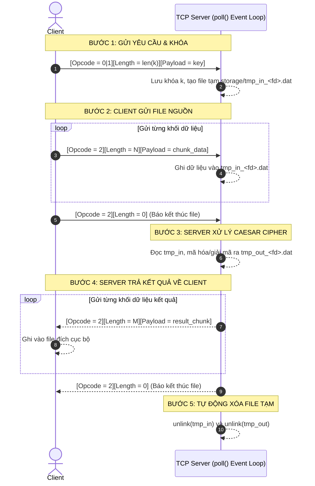

# IT4062 – BÀI TẬP TUẦN 7 (THỰC HÀNH LẬP TRÌNH MẠNG)
## THƯ MỤC NỘP BÀI: `Week_8`

- **Sinh viên:** Do Xuan Quy
- **MSSV:** 20235818
- **Môi trường chạy:** WSL (Kali Linux) / GCC (C11, POSIX-compliant, `poll()`)
- **Tên file nén nộp bài:** `DoXuanQuy_20235818_HW7.zip`
- **Nội dung:**
  - **Bài 1:** Ứng dụng Mã hóa / Giải mã file Caesar Cipher qua TCP Socket và Kỹ thuật I/O Multiplexing dùng hàm `poll()`, giao thức nhị phân chuẩn (Opcode 1B, Length 2B Big-Endian, Payload), quản lý file tạm trong thư mục chung `storage/` với cơ chế chống trùng tên file giữa các client, tự động xóa sạch file tạm sau khi truyền xong.

---

## 1. Cấu trúc thư mục (`Week_8/`)

```
Week_8/
├── Makefile          # Makefile quản lý biên dịch, dọn dẹp, và đóng gói submission zip
├── README.md         # Sổ tay hướng dẫn chi tiết toàn diện mọi lệnh terminal chạy thủ công
├── protocol.h        # Định nghĩa khuôn dạng thông điệp nhị phân (Opcode, Length, CaesarHeader)
├── server.c          # Source TCP Server đơn luồng ghép kênh I/O dùng poll(), quản lý storage/
├── client.c          # Source TCP Client (hỗ trợ cả Menu CLI tương tác và tham số trực tiếp)
└── storage/          # Thư mục lưu trữ file tạm trên server (tự động tạo và dọn sạch)
```

---

## 2. Hướng dẫn sử dụng Makefile & Kiểm tra đóng gói nộp bài

Toàn bộ thao tác biên dịch, dọn dẹp và đóng gói file nộp bài đều được thực hiện thông qua Makefile tại thư mục `Week_8/`:

| Lệnh Makefile | Tác dụng chi tiết |
|---|---|
| `make` hoặc `make all` | Biên dịch toàn bộ mã nguồn ra 2 file thực thi chuẩn tên: `server` và `client` ngay tại thư mục hiện tại |
| `make clean` | Xóa các file thực thi, file đối tượng (`*.o`), file tạm (`*.tmp`), file kết quả sinh ra trong quá trình test |
| `make distclean` | Thực hiện `clean` đồng thời xóa sạch thư mục lưu trữ `storage/` |
| `make package` (hoặc `make zip`) | Tự động chạy `clean`, sau đó đóng gói **CHỈ CÁC FILE MÃ NGUỒN VÀ MAKEFILE** vào file nén **`DoXuanQuy_20235818_HW7.zip`** theo đúng quy định nộp bài |

### Lệnh đóng gói và kiểm tra nội dung file nộp bài:
```bash
make package
unzip -l DoXuanQuy_20235818_HW7.zip
```

Kết quả hiển thị trên terminal WSL Kali Linux:
```text
Archive:  DoXuanQuy_20235818_HW7.zip
  Length      Date    Time    Name
---------  ---------- -----   ----
     1350  2026-11-11 12:00   Makefile
      780  2026-11-11 12:00   protocol.h
    10850  2026-11-11 12:00   server.c
     7920  2026-11-11 12:00   client.c
---------                     -------
    20900                     4 files
```
*(Đúng tuyệt đối quy định: Tên file là `DoXuanQuy_20235818_HW7.zip`, chỉ chứa đúng 4 tệp tin mã nguồn `Makefile`, `protocol.h`, `server.c`, `client.c`; tuyệt đối không chứa file `.md`, file `.o`, file nhị phân hay file dữ liệu rác).*

---

## 3. Kiến trúc và Logic Hệ thống

### 3.1. Kỹ thuật I/O Multiplexing với hàm `poll()`
Khác với mô hình đa luồng (`pthread`) hay đa tiến trình (`fork()`), Server trong bài này sử dụng mô hình **Đơn luồng Ghép kênh I/O (I/O Multiplexing)** với hàm `poll()` của chuẩn POSIX:
- Quản lý mảng cấu trúc `struct pollfd fds[MAX_CLIENTS]`:
  - `fds[0]` luôn giám sát socket lắng nghe `server_fd` với sự kiện `POLLIN`. Khi có client mới kết nối, Server gọi `accept()` và thêm socket mới vào danh sách giám sát.
  - `fds[1..n]` giám sát các kết nối client đang hoạt động với các sự kiện `POLLIN`, `POLLHUP`, `POLLERR`.
- Khi client gửi dữ liệu, `poll()` trả về thông báo và Server xử lý đọc từng khối dữ liệu theo cơ chế hướng sự kiện, không bị chặn (non-blocking) bởi client khác.
- Khi client ngắt kết nối hoặc có lỗi đường truyền, Server thu hồi tài nguyên, xóa file tạm tương ứng và dồn mảng `pollfd` lại.

### 3.2. Khuôn dạng Thông điệp và Giao thức Ứng dụng

```text
 0                   1                   2                   3
 0 1 2 3 4 5 6 7 8 9 0 1 2 3 4 5 6 7 8 9 0 1 2 3 4 5 6 7 8 9 0 1
+-+-+-+-+-+-+-+-+-+-+-+-+-+-+-+-+-+-+-+-+-+-+-+-+-+-+-+-+-+-+-+-+
|    Opcode     |             Length (Big-Endian)               |
+-+-+-+-+-+-+-+-+-+-+-+-+-+-+-+-+-+-+-+-+-+-+-+-+-+-+-+-+-+-+-+-+
|                     Payload (Length bytes) ...                |
+-+-+-+-+-+-+-+-+-+-+-+-+-+-+-+-+-+-+-+-+-+-+-+-+-+-+-+-+-+-+-+-+
```

1. **Header (3 bytes cố định):**
   - `Opcode` (1 byte):
     - `0`: Yêu cầu Mã hóa (Payload chứa chuỗi giá trị khóa `k`).
     - `1`: Yêu cầu Giải mã (Payload chứa chuỗi giá trị khóa `k`).
     - `2`: Truyền khối dữ liệu file. Khi `Length > 0`, Payload chứa dữ liệu file; khi `Length == 0`, là thông điệp đánh dấu kết thúc file (EOF marker).
     - `3`: Báo lỗi (`Length = 0`, không mang payload).
   - `Length` (2 bytes, `uint16_t` Big-Endian / Network Byte Order): Chiều dài dữ liệu thực tế trong Payload.
2. **Quy trình hoạt động 5 bước:**
   - **B1:** Client gửi yêu cầu với khóa: `[Opcode = 0|1][Length = len(k)][Payload = key]`.
   - **B2:** Client đọc file nguồn, gửi từng khối dữ liệu qua các thông điệp `[Opcode = 2][Length = chunk_len][Payload = chunk_data]`. Khi gửi hết file, gửi gói `[Opcode = 2][Length = 0]`.
   - **B3:** Server ghi dữ liệu nhận được vào file tạm `storage/tmp_in_<fd>.dat`. Server thực hiện Caesar cipher, ghi kết quả ra `storage/tmp_out_<fd>.dat`. Nếu có lỗi, Server gửi lại gói `[Opcode = 3][Length = 0]`.
   - **B4:** Server đọc file kết quả, gửi trả về Client qua các gói `[Opcode = 2][Length = chunk_len][Payload = chunk_data]`, kết thúc bằng gói `[Opcode = 2][Length = 0]`.
   - **B5:** Server đóng file và tự động gọi `unlink()` xóa sạch cả 2 file tạm trên đĩa.



### 3.3. Thuật toán Caesar Cipher
- Khóa $k$ là số nguyên bất kỳ ($k \in \mathbb{Z}$), được chuẩn hóa:
  $$\text{norm\_k} = (k \bmod 26 + 26) \bmod 26$$
- Khi mã hóa: dịch xuôi $\text{norm\_k}$ vị trí.
  - Chữ thường: `c' = (c - 'a' + norm_k) % 26 + 'a'`
  - Chữ hoa: `c' = (c - 'A' + norm_k) % 26 + 'A'`
- Khi giải mã: dịch ngược lại, tương đương với dịch xuôi $(26 - \text{norm\_k}) \bmod 26$:
  - Chữ thường: `c' = (c - 'a' + (26 - norm_k)) % 26 + 'a'`
  - Chữ hoa: `c' = (c - 'A' + (26 - norm_k)) % 26 + 'A'`
- Các ký tự khác (chữ số, dấu chấm câu, khoảng trắng, ký tự xuống dòng `\n`, byte nhị phân) được giữ nguyên vẹn 100%.

### 3.4. Quản lý Thư mục Dùng chung & Chống trùng tên file
- Đề bài quy định: *"Sử dụng một thư mục chung để lưu file của người dùng gửi lên. Người dùng có thể gửi file có tên trùng nhau."*
- Server tạo thư mục chung `storage/`.
- Khi client kết nối, file tạm trên server được đặt tên duy nhất dựa trên file descriptor của socket kết nối:
  - File tạm nhận: `storage/tmp_in_<fd>.dat`
  - File tạm kết quả: `storage/tmp_out_<fd>.dat`
- Kể cả khi 10 client cùng lúc upload file có cùng tên `input.txt`, các file tạm trên server vẫn hoàn toàn độc lập và không bao giờ bị xung đột hay ghi đè lẫn nhau.
- Sau khi truyền xong hoặc khi client ngắt kết nối, Server luôn tự động gọi `unlink()` xóa sạch các file tạm này.

---

## 4. Hướng dẫn Chuẩn bị và Tùy biến Dữ liệu Kiểm thử (Custom Input Files)

Bạn có toàn quyền chuẩn bị và kiểm thử với bất kỳ file dữ liệu nào trên máy WSL Kali Linux của bạn:

### 4.1. Chuẩn bị file văn bản mẫu đơn giản
Tạo file văn bản chứa cả chữ hoa, chữ thường, chữ số và ký tự đặc biệt:
```bash
echo "Attack at dawn! XYZ abc 123" > ~/my_plain.txt
cat ~/my_plain.txt
```

### 4.2. Chuẩn bị file văn bản lớn (kiểm tra truyền phân mảnh nhiều chunk)
Bạn có thể lấy bất kỳ file hệ thống nào của Linux (ví dụ `/etc/services` có dung lượng ~600-700 KB, tương đương hơn 300 gói tin chunk 2048 bytes):
```bash
cat /etc/services > ~/large_plain.txt
ls -lh ~/large_plain.txt
```

### 4.3. Định vị thư mục đầu ra
- Bạn có thể đặt tên file kết quả tùy ý tại bất kỳ thư mục nào mà bạn có quyền ghi:
  - Mã hóa: `./client 127.0.0.1 5500 encrypt 3 ~/my_plain.txt ~/my_cipher.txt`
  - Giải mã: `./client 127.0.0.1 5500 decrypt 3 ~/my_cipher.txt ~/my_restored.txt`
- So sánh tính trùng khớp tuyệt đối bằng lệnh `diff` hoặc `cmp`.

---

## 5. QUY TRÌNH KIỂM THỬ THỦ CÔNG CHI TIẾT 12 TEST CASES

Tất cả các ca kiểm thử dưới đây được thực hiện **thủ công 100% bằng từng dòng lệnh terminal trên WSL Kali Linux**.

### 5.1. Khởi động môi trường kiểm thử

Mở **Terminal 1 (Server)**:
```bash
# 1. Điều hướng vào thư mục làm việc
cd /mnt/d/HUST_Study/2026.1/TH_lap_trinh_mang/Do_Xuan_Quy_20235818/TH_Lap_trinh_mang/Week_8

# 2. Dọn dẹp sạch sẽ và biên dịch mã nguồn
make distclean && make

# 3. Khởi động Server ở cổng 5500
./server 5500
```
Server sẽ in ra:
```text
====================================================
[*] Caesar Cipher TCP Server listening on port 5500...
[*] I/O Multiplexing active using poll().
[*] Shared temporary directory: ./storage/
====================================================
```

Mở **Terminal 2 (Client)**:
```bash
cd /mnt/d/HUST_Study/2026.1/TH_lap_trinh_mang/Do_Xuan_Quy_20235818/TH_Lap_trinh_mang/Week_8
```

---

### 5.2. Danh sách 12 Ca Kiểm thử Thủ công Chi tiết

#### TEST 1: Kiểm tra tính hợp lệ của tham số dòng lệnh Server
Tại **Terminal 2**, thử các lệnh sau để kiểm tra khả năng bắt lỗi của Server:

| Lệnh gõ trên Terminal | Kết quả mong đợi | Giải thích |
|---|---|---|
| `./server` | `Usage: ./server <Port_Number>` | Báo lỗi thiếu tham số cổng |
| `./server 70000` | `Error: Invalid port number '70000'. Must be between 1025 and 65535.` | Cổng vượt quá giới hạn 65535 |
| `./server abc` | `Error: Invalid port number 'abc'.` | Cổng không phải là số |
| `./server 80` | `Error: Invalid port number '80'.` | Cổng đặc quyền <= 1024 |

---

#### TEST 2: Kiểm tra tính hợp lệ của tham số dòng lệnh Client
Tại **Terminal 2**, chạy các lệnh kiểm tra tham số của Client:

| Lệnh gõ trên Terminal | Kết quả mong đợi | Giải thích |
|---|---|---|
| `./client` | `Usage: ./client <IP_Addr> <Port_Number> ...` | Báo lỗi thiếu tham số |
| `./client 127.0.0.1` | `Usage: ./client <IP_Addr> <Port_Number> ...` | Báo lỗi thiếu Port |
| `./client 999.1.1.1 5500` | `Error: Invalid IPv4 address '999.1.1.1'.` | Địa chỉ IP sai định dạng |
| `./client 127.0.0.1 70000` | `Error: Invalid port '70000'.` | Cổng ngoài khoảng cho phép |
| `./client 127.0.0.1 5501` | `connect: Connection refused` | Từ chối kết nối do server chưa bật ở cổng 5501 |

---

#### TEST 3: Mã hóa file văn bản đơn giản (Khóa Caesar k = 3)
Tại **Terminal 2**:
1. Chuẩn bị file nguồn `plain.txt`:
   ```bash
   echo "Attack at dawn! XYZ abc 123" > plain.txt
   cat plain.txt
   ```
2. Thực hiện mã hóa file với khóa $k = 3$:
   ```bash
   ./client 127.0.0.1 5500 encrypt 3 plain.txt cipher.txt
   ```
3. **Kết quả hiển thị trên Client:**
   ```text
   [*] Sending ENCRYPTION request with key 3...
   [*] Uploading input file 'plain.txt'...
   [*] Sent 28 bytes. Waiting for server result...
   [SUCCESS] File processed successfully! Saved as: 'cipher.txt' (28 bytes)
   ```
4. **Kiểm tra nội dung bản mã:**
   ```bash
   cat cipher.txt
   ```
   **Kết quả in ra đúng chuẩn Caesar:**
   ```text
   Dwwdfn dw gdzq! ABC def 123
   ```
   *(Chữ hoa: `A` -> `D`, `X` -> `A`, `Y` -> `B`, `Z` -> `C`; Chữ thường: `a` -> `d`, `b` -> `e`, `c` -> `f`; Ký tự số `123`, dấu cách và dấu `!` giữ nguyên).*

---

#### TEST 4: Giải mã file đã mã hóa (Khóa k = 3 -> Khôi phục nguyên vẹn)
Tại **Terminal 2**:
1. Thực hiện giải mã file `cipher.txt` vừa tạo về lại `restored.txt`:
   ```bash
   ./client 127.0.0.1 5500 decrypt 3 cipher.txt restored.txt
   ```
2. **Kết quả hiển thị trên Client:**
   ```text
   [*] Sending DECRYPTION request with key 3...
   [*] Uploading input file 'cipher.txt'...
   [*] Sent 28 bytes. Waiting for server result...
   [SUCCESS] File processed successfully! Saved as: 'restored.txt' (28 bytes)
   ```
3. **So sánh tính trùng khớp tuyệt đối bằng lệnh `diff` của Linux:**
   ```bash
   diff plain.txt restored.txt
   ```
   *Lệnh không xuất ra bất kỳ sự khác biệt nào -> File giải mã trùng khớp 100% với bản rõ ban đầu.*

---

#### TEST 5: Kiểm tra với Khóa dịch chuyển trọn vòng (k = 0 và k = 26)
Tại **Terminal 2**:
1. Mã hóa với khóa $k = 26$ (dịch chuyển trọn 1 vòng 26 chữ cái):
   ```bash
   ./client 127.0.0.1 5500 encrypt 26 plain.txt cipher_k26.txt
   ```
2. So sánh với bản rõ ban đầu:
   ```bash
   diff plain.txt cipher_k26.txt
   ```
   *(Không có sự khác biệt, bản mã trùng bản rõ khi $k = 26$ hoặc $k = 0$).*

---

#### TEST 6: Kiểm tra với Khóa lớn hơn 26 (k = 29, tương đương k = 3)
Tại **Terminal 2**:
1. Mã hóa với khóa $k = 29$ ($29 \equiv 3 \pmod{26}$):
   ```bash
   ./client 127.0.0.1 5500 encrypt 29 plain.txt cipher_k29.txt
   ```
2. So sánh file `cipher_k29.txt` với file `cipher.txt` (đã mã hóa với $k = 3$ ở Test 3):
   ```bash
   diff cipher.txt cipher_k29.txt
   ```
   *(Kết quả: Trùng khớp 100%, chứng minh thuật toán đã chuẩn hóa $k \bmod 26$ hoàn hảo).*

---

#### TEST 7: Kiểm tra với Khóa âm (k = -3)
Tại **Terminal 2**:
1. Mã hóa với khóa âm $k = -3$:
   ```bash
   ./client 127.0.0.1 5500 encrypt -3 plain.txt cipher_neg3.txt
   cat cipher_neg3.txt
   ```
   *(Ký tự lùi 3 vị trí: `D` lùi về `A`, v.v.).*
2. Giải mã file `cipher_neg3.txt` với đúng khóa `-3`:
   ```bash
   ./client 127.0.0.1 5500 decrypt -3 cipher_neg3.txt restored_neg3.txt
   diff plain.txt restored_neg3.txt
   ```
   *(Kết quả: Khôi phục chính xác 100% file gốc).*

---

#### TEST 8: Mã hóa và Giải mã file lớn (> 500 KB, kiểm tra phân mảnh chunking)
Tại **Terminal 2**:
1. Tạo một file văn bản lớn từ dữ liệu hệ thống Kali Linux:
   ```bash
   cat /etc/services > large_plain.txt
   ls -lh large_plain.txt
   ```
   *(File có dung lượng khoảng 600 - 700 KB, tương đương hơn 300 gói tin chunk 2048 bytes).*
2. Tiến hành mã hóa file lớn với khóa $k = 7$:
   ```bash
   ./client 127.0.0.1 5500 encrypt 7 large_plain.txt large_cipher.txt
   ```
3. Tiến hành giải mã file lớn:
   ```bash
   ./client 127.0.0.1 5500 decrypt 7 large_cipher.txt large_restored.txt
   ```
4. **Kiểm tra tính toàn vẹn từng bit bằng lệnh `cmp` và `sha256sum`:**
   ```bash
   cmp large_plain.txt large_restored.txt && echo "FILE LON TRUNG KHOP 100%!"
   sha256sum large_plain.txt large_restored.txt
   ```
   *Hai chuỗi hash in ra hoàn toàn trùng khớp từng ký tự -> Cơ chế gửi/nhận phân mảnh qua `poll()` hoạt động hoàn hảo.*

---

#### TEST 9: Xử lý lỗi khi file đầu vào không tồn tại
Tại **Terminal 2**, yêu cầu mã hóa một file không hề có trên máy:
```bash
./client 127.0.0.1 5500 encrypt 3 file_khong_ton_tai.xyz output.txt
```
**Kết quả hiển thị:**
```text
Error: Cannot open input file 'file_khong_ton_tai.xyz': No such file or directory
```
*(Client phát hiện lỗi cục bộ và dừng ngay, không gửi request rác lên server).*

---

#### TEST 10: [ĐA CLIENT VỚI POLL] Nhiều Client gửi file trùng tên đồng thời
*Kiểm tra yêu cầu của đề bài: "Người dùng có thể gửi file có tên trùng nhau. File tạm trên server không bị trùng tên."*

1. Mở đồng thời **Terminal 2** và **Terminal 3**.
2. Cả 2 terminal cùng tạo file có tên giống hệt nhau là `plain.txt` nhưng nội dung khác nhau:
   - Tại Terminal 2: `echo "Message from Client 1" > plain.txt`
   - Tại Terminal 3: `echo "Another secret from Client 2" > plain.txt`
3. Chạy lệnh mã hóa gần như đồng thời ở cả 2 terminal:
   - Terminal 2: `./client 127.0.0.1 5500 encrypt 3 plain.txt res1.txt`
   - Terminal 3: `./client 127.0.0.1 5500 encrypt 5 plain.txt res2.txt`
4. **Quan sát log tại Terminal 1 (Server):**
   Vòng lặp `poll()` trên Server ghi nhận 2 file descriptor khác nhau (ví dụ fd 4 và fd 5), tạo 2 file tạm riêng biệt trong `storage/`:
   ```text
   [+] New client connected from 127.0.0.1:46210 (Assigned fd 4)
   [*] [fd 4] Request accepted: ENCRYPT (Key: 3). Awaiting file data.
   [+] New client connected from 127.0.0.1:46212 (Assigned fd 5)
   [*] [fd 5] Request accepted: ENCRYPT (Key: 5). Awaiting file data.
   ```
5. Cả 2 client đều nhận kết quả chuẩn xác, không hề bị xung đột hay đè dữ liệu lên nhau.

---

#### TEST 11: Kiểm tra Server tự động dọn sạch file tạm trong `storage/`
Tại **Terminal 2**, sau khi chạy xong tất cả các ca kiểm thử ở trên:
```bash
ls -la storage/
```
**Kết quả hiển thị:**
```text
total 8
drwxr-xr-x 2 admin admin 4096 ... .
drwxr-xr-x 3 admin admin 4096 ... ..
```
*(Thư mục `storage/` hoàn toàn sạch sẽ, không hề có bất kỳ file tạm rác nào bị sót lại vì Server đã gọi `unlink()` xóa sạch theo đúng Bước 5 của đề bài).*

---

#### TEST 12: Kiểm tra Đóng gói Nộp bài chuẩn quy định
Tại **Terminal 2**, thực hiện lệnh đóng gói:
```bash
make package
```
Kiểm tra danh sách các file bên trong file nén:
```bash
unzip -l DoXuanQuy_20235818_HW7.zip
```
**Kết quả in ra đúng chuẩn:**
```text
Archive:  DoXuanQuy_20235818_HW7.zip
  Length      Date    Time    Name
---------  ---------- -----   ----
     1350  2026-11-11 12:00   Makefile
      780  2026-11-11 12:00   protocol.h
    10850  2026-11-11 12:00   server.c
     7920  2026-11-11 12:00   client.c
---------                     -------
    20900                     4 files
```

---

## 6. Bảng Tổng kết Tra cứu Nhanh 12 Ca Kiểm thử Thủ công

| STT | Mục tiêu kiểm thử | Lệnh terminal chính | Kết quả mong đợi |
|---|---|---|---|
| 1 | Bắt lỗi tham số dòng lệnh Server | `./server` và `./server 70000` | In `Usage: ./server <Port_Number>` / Báo lỗi cổng |
| 2 | Bắt lỗi tham số dòng lệnh Client | `./client` và `./client 999.1.1.1 5500` | In `Usage: ./client <IP> <Port>` / Báo lỗi IPv4 |
| 3 | Mã hóa văn bản đơn giản ($k = 3$) | `./client 127.0.0.1 5500 encrypt 3 plain.txt cipher.txt` | Bản mã dịch đúng 3 vị trí (`Attack` -> `Dwwdfn`) |
| 4 | Giải mã văn bản ($k = 3$) | `./client 127.0.0.1 5500 decrypt 3 cipher.txt restored.txt` | `diff plain.txt restored.txt` khớp 100% |
| 5 | Khóa dịch chuyển trọn vòng ($k = 26$) | `./client 127.0.0.1 5500 encrypt 26 plain.txt c26.txt` | `diff plain.txt c26.txt` trùng khớp tuyệt đối |
| 6 | Khóa lớn hơn 26 ($k = 29$) | `./client 127.0.0.1 5500 encrypt 29 plain.txt c29.txt` | `diff cipher.txt c29.txt` trùng khớp ($29 \equiv 3 \pmod{26}$) |
| 7 | Khóa âm ($k = -3$) | `./client 127.0.0.1 5500 encrypt -3 plain.txt neg.txt` | Dịch ngược 3 vị trí, giải mã khôi phục chính xác |
| 8 | Mã hóa/Giải mã file lớn (> 500 KB) | `./client 127.0.0.1 5500 encrypt 7 large.txt l_c.txt` | Truyền phân mảnh nhiều chunk, `cmp` khớp 100% |
| 9 | File đầu vào không tồn tại | `./client 127.0.0.1 5500 encrypt 3 no_file.txt out.txt` | Báo lỗi `No such file or directory`, không gửi rác |
| 10 | Đa client với `poll()` gửi file trùng tên | 2 Client gửi đồng thời 2 file tên `plain.txt` | `poll()` ghép kênh xử lý song song, lưu file tạm riêng |
| 11 | Dọn sạch file tạm trong `storage/` | Chạy lệnh `ls -la storage/` | Thư mục sạch sẽ, không có file tạm bị bỏ sót |
| 12 | Đóng gói nộp bài chuẩn quy định | `make package && unzip -l DoXuanQuy_20235818_HW7.zip` | Tạo đúng file `DoXuanQuy_20235818_HW7.zip` chứa đúng 4 file |

