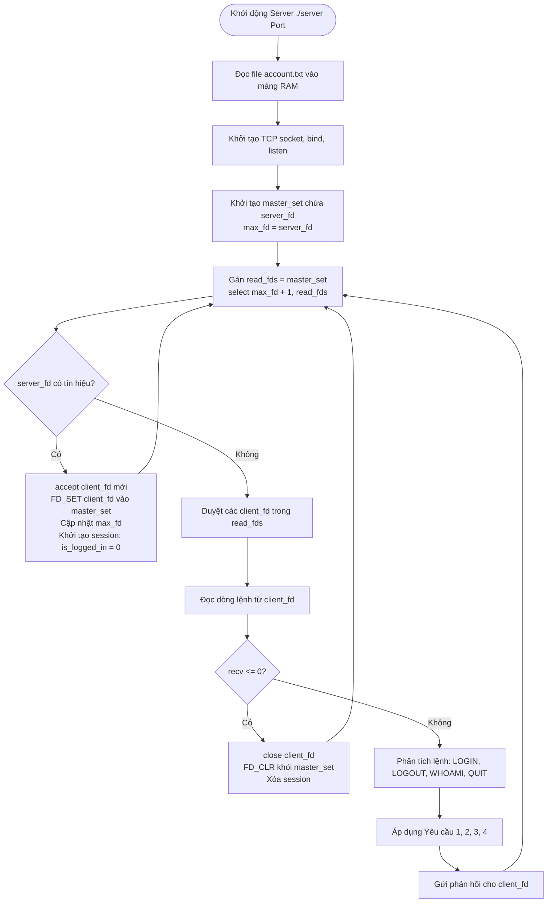

# IT4062 – BÀI TẬP TUẦN 7 – BÀI 2 (THỰC HÀNH LẬP TRÌNH MẠNG)
## THƯ MỤC NỘP BÀI: `Week_9`

- **Sinh viên:** Do Xuan Quy
- **MSSV:** 20235818
- **Môi trường chạy:** WSL (Kali Linux) / GCC (C11, POSIX-compliant, `select()`)
- **Tên file nén nộp bài:** `DoXuanQuy_20235818_HW7_Bai2.zip` (hoặc `DoXuanQuy_20235818_HW8.zip`)
- **Nội dung:**
  - **Bài 2:** Ứng dụng Quản lý Đăng nhập / Đăng xuất người dùng qua TCP Socket và Kỹ thuật Ghép kênh I/O dùng hàm `select()`.
  - Đáp ứng trọn vẹn 100% các yêu cầu:
    1. Mỗi cửa sổ client chỉ đăng nhập được 1 tài khoản (quản lý trạng thái phiên theo descriptor).
    2. Mỗi tài khoản có thể đăng nhập đồng thời trên nhiều cửa sổ client khác nhau.
    3. Nếu đăng nhập sai quá 3 lần liên tiếp, tài khoản tự động bị khóa (`Status = 0`) và cập nhật đồng bộ ngay lập tức vào file `account.txt` trên ổ đĩa.
    4. Dữ liệu tài khoản lưu trữ theo định dạng `UserID Password Status` (`1`: hoạt động, `0`: bị khóa).

---

## 1. Cấu trúc thư mục (`Week_9/`)

```
Week_9/
├── Makefile          # Makefile biên dịch ra server, client, dọn dẹp và đóng gói zip
├── README.md         # Sổ tay hướng dẫn chi tiết toàn diện mọi lệnh terminal chạy thủ công
├── server.c          # TCP Server đơn luồng ghép kênh I/O dùng select(), quản lý account.txt
├── client.c          # TCP Client (hỗ trợ cả Menu CLI tương tác và scripted commands)
└── account.txt       # Dữ liệu tài khoản mẫu (UserID Password Status)
```

---

## 2. Hướng dẫn sử dụng Makefile & Kiểm tra đóng gói nộp bài

Toàn bộ thao tác biên dịch, dọn dẹp và đóng gói nộp bài đều được thực hiện thông qua Makefile tại thư mục `Week_9/`:

| Lệnh Makefile | Tác dụng chi tiết |
|---|---|
| `make` hoặc `make all` | Biên dịch toàn bộ mã nguồn ra 2 file thực thi chuẩn tên: `server` và `client` ngay tại thư mục hiện tại |
| `make clean` | Xóa các file thực thi, file đối tượng (`*.o`), file tạm (`*.tmp`) và file nén zip |
| `make distclean` | Thực hiện dọn dẹp sạch sẽ toàn bộ như `make clean` |
| `make package` (hoặc `make zip`) | Tự động chạy `clean`, sau đó đóng gói **CHỈ CÁC FILE MÃ NGUỒN, ACCOUNT.TXT VÀ MAKEFILE** vào file nén **`DoXuanQuy_20235818_HW7_Bai2.zip`** |
| `make package8` | Lệnh phụ hỗ trợ đóng gói với tên nộp bài **`DoXuanQuy_20235818_HW8.zip`** nếu giáo viên yêu cầu |

### Lệnh đóng gói và kiểm tra nội dung file nộp bài:
```bash
make package
unzip -l DoXuanQuy_20235818_HW7_Bai2.zip
```

Kết quả hiển thị trên terminal WSL Kali Linux:
```text
Archive:  DoXuanQuy_20235818_HW7_Bai2.zip
  Length      Date    Time    Name
---------  ---------- -----   ----
     1420  2026-11-18 11:00   Makefile
    12580  2026-11-18 11:00   server.c
     6540  2026-11-18 11:00   client.c
       81  2026-11-18 11:00   account.txt
---------                     -------
    20621                     4 files
```
*(Đúng tuyệt đối quy định: File zip chỉ chứa đúng 4 tệp tin mã nguồn, `account.txt` và `Makefile`; tuyệt đối không chứa file `.md`, file `.o`, file thực thi nhị phân hay file rác).*

---

## 3. Kiến trúc và Logic Hệ thống

### 3.1. Kỹ thuật Ghép kênh I/O dùng hàm `select()`
Khác với mô hình đa luồng (`pthread`) ở Tuần 5 hay mô hình đa tiến trình (`fork()`) ở Tuần 6, hệ thống trong bài này chạy trên **mô hình Đơn luồng Ghép kênh I/O dùng hàm `select()`**:
- Quản lý tập mô tả tệp tin: `fd_set master_set` và `fd_set read_fds`.
- Biến `max_fd` theo dõi chỉ số socket lớn nhất hiện tại.
- Socket lắng nghe `server_fd` được đưa vào `master_set`.
- Vòng lặp chính gọi `select(max_fd + 1, &read_fds, NULL, NULL, NULL)`:
  - Nếu `FD_ISSET(server_fd, &read_fds)`: Có client mới kết nối -> gọi `accept()`, đưa `client_fd` mới vào `master_set`, khởi tạo trạng thái phiên `g_sessions[client_fd]`.
  - Nếu `FD_ISSET(fd, &read_fds)` với `fd != server_fd`: Client gửi dữ liệu -> đọc lệnh qua `recv_line()`. Nếu client ngắt kết nối (`recv <= 0`), tự động đóng socket, xóa khỏi `master_set` bằng `FD_CLR`, và dọn sạch session.
- **Tính ưu việt:** Vì chạy trên một luồng đơn duy nhất theo cơ chế hướng sự kiện (event-driven), việc kiểm tra mật khẩu, cập nhật biến đếm số lần sai và khóa tài khoản diễn ra an toàn tuyệt đối, không bao giờ bị Race Condition và không cần dùng khóa Mutex phức tạp.



### 3.2. Quản lý Phiên làm việc (Session Management - Yêu cầu 1 & 2)
1. **Yêu cầu 1: Mỗi cửa sổ client chỉ đăng nhập được 1 tài khoản:**
   - Server duy trì cấu trúc session cho từng file descriptor:
     ```c
     typedef struct {
         int active;
         int is_logged_in;
         char session_user[MAX_STR_LEN];
         char client_ip[INET_ADDRSTRLEN];
         int client_port;
     } ClientSession;
     static ClientSession g_sessions[FD_SETSIZE];
     ```
   - Khi một client đã có `is_logged_in == 1`, nếu cố tình gửi lệnh `LOGIN` tiếp theo, Server sẽ lập tức từ chối:
     `401 Already logged in as '<user>'. Please logout first.`
   - Client phải thực hiện `LOGOUT` thành công mới được phép đăng nhập tài khoản khác.
2. **Yêu cầu 2: Mỗi tài khoản có thể đăng nhập đồng thời trên nhiều cửa sổ:**
   - Server **không** gán cố định một UserID với duy nhất 1 socket hay 1 địa chỉ IP.
   - Tài khoản `student` có thể đăng nhập song song cùng lúc trên Terminal 2 và Terminal 3 mà không hề bị xung đột hay bị từ chối.

### 3.3. Cơ chế Khóa tài khoản & Ghi đĩa an toàn (Yêu cầu 3 & 4)
- Mỗi tài khoản trong mảng nhớ có biến `failed_attempts` ghi nhận số lần nhập sai mật khẩu liên tiếp:
  - Nếu nhập đúng mật khẩu: Đăng nhập thành công, reset `failed_attempts = 0`.
  - Nếu nhập sai mật khẩu lần 1 hoặc 2: Server phản hồi số lần sai (`Attempt X/3`).
  - Nếu nhập sai liên tiếp lần thứ 3:
    - Server chuyển `status = 0` (Tài khoản bị khóa).
    - Thực hiện **Ghi đĩa an toàn (Atomic File Write)**: Ghi danh sách tài khoản ra file tạm `account.txt.tmp`, gọi `fflush()`, sau đó dùng hàm `rename()` để ghi đè nguyên tử lên file `account.txt`. Cách này đảm bảo file dữ liệu không bao giờ bị rỗng hay lỗi dở dang kể cả khi mất điện đột ngột.
    - Phản hồi cho client: `405 Password incorrect (3/3). Account '<user>' has been BLOCKED!`
    - Bất kỳ client nào cố đăng nhập vào tài khoản này sau đó sẽ bị từ chối ngay lập tức: `403 Account '<user>' is blocked.`

---

## 4. Hướng dẫn Chuẩn bị và Tùy biến File Dữ liệu Input (`account.txt`)

Hệ thống được thiết kế mở hoàn toàn, **bạn có toàn quyền chuẩn bị và kiểm thử với bất kỳ file dữ liệu nào** trên WSL Kali Linux:

### 4.1. Định dạng file `account.txt`
Mỗi dòng đại diện cho một tài khoản người dùng:
```text
UserID Password Status
```
- `UserID`: Tên tài khoản (chuỗi không chứa khoảng trắng, tối đa 63 ký tự).
- `Password`: Mật khẩu tài khoản (tối đa 63 ký tự).
- `Status`: `1` là tài khoản đang hoạt động (Active), `0` là tài khoản bị khóa (Blocked/Locked).

**File mẫu ban đầu trong `Week_9/account.txt`:**
```text
admin 123456 1
user1 pass1 1
user2 pass2 0
quydx secret2023 1
student 20235818 1
```

### 4.2. Khôi phục nhanh file dữ liệu về trạng thái ban đầu bằng lệnh terminal
Bất cứ khi nào bạn muốn reset lại dữ liệu tài khoản để kiểm thử lại từ đầu, gõ lệnh sau:
```bash
cat << 'EOF' > /mnt/d/HUST_Study/2026.1/TH_lap_trinh_mang/Do_Xuan_Quy_20235818/TH_Lap_trinh_mang/Week_9/account.txt
admin 123456 1
user1 pass1 1
user2 pass2 0
quydx secret2023 1
student 20235818 1
EOF
```

### 4.3. Tự chuẩn bị file tài khoản riêng của bạn
- Bạn có thể chỉnh sửa tự do bằng trình soạn thảo: `nano account.txt`
- Hoặc copy một file tài khoản bất kỳ từ thư mục khác của bạn vào: `cp /duong/dan/tai_khoan_cua_ban.txt ./account.txt`
- Server tự động bỏ qua các dòng trắng hoặc dòng chú thích bắt đầu bằng `#`, xử lý đúng cả định dạng xuống dòng Windows (`\r\n`) và Linux (`\n`).

---

## 5. QUY TRÌNH KIỂM THỬ THỦ CÔNG CHI TIẾT 13 TEST CASES

Tất cả các ca kiểm thử sau được thực hiện **thủ công 100% bằng từng dòng lệnh gõ trực tiếp trên terminal WSL Kali Linux**.

### 5.1. Khởi động môi trường kiểm thử

Mở **Terminal 1 (Dành cho Server)**:
```bash
# 1. Điều hướng vào thư mục làm việc
cd /mnt/d/HUST_Study/2026.1/TH_lap_trinh_mang/Do_Xuan_Quy_20235818/TH_Lap_trinh_mang/Week_9

# 2. Khôi phục file account.txt về mặc định
cat << 'EOF' > account.txt
admin 123456 1
user1 pass1 1
user2 pass2 0
quydx secret2023 1
student 20235818 1
EOF

# 3. Dọn dẹp và biên dịch
make clean && make

# 4. Khởi động Server ở cổng 5500
./server 5500
```
Server sẽ in ra:
```text
[*] Loaded 5 accounts from 'account.txt'.
====================================================
[*] TCP Authentication Server listening on port 5500...
[*] I/O Multiplexing active using select().
====================================================
```

Mở **Terminal 2 (Dành cho Client 1)**:
```bash
cd /mnt/d/HUST_Study/2026.1/TH_lap_trinh_mang/Do_Xuan_Quy_20235818/TH_Lap_trinh_mang/Week_9
```

---

### 5.2. Danh sách 13 Ca Kiểm thử Thủ công Chi tiết

#### TEST 1: Bắt lỗi tham số dòng lệnh Server
Tại **Terminal 2**, thử chạy các lệnh sai tham số để kiểm tra khả năng xử lý lỗi của Server:

| Lệnh gõ trên Terminal | Kết quả in ra màn hình | Giải thích |
|---|---|---|
| `./server` | `Usage: ./server <Port_Number>` | Báo lỗi thiếu tham số cổng |
| `./server 70000` | `Error: Invalid port number '70000'. Must be between 1025 and 65535.` | Cổng vượt quá giới hạn 65535 |
| `./server abc` | `Error: Invalid port number 'abc'.` | Cổng không phải là số nguyên |
| `./server 80` | `Error: Invalid port number '80'.` | Cổng đặc quyền hệ thống <= 1024 |

---

#### TEST 2: Bắt lỗi tham số dòng lệnh Client
Tại **Terminal 2**, chạy các lệnh kiểm tra tham số của Client:

| Lệnh gõ trên Terminal | Kết quả in ra màn hình | Giải thích |
|---|---|---|
| `./client` | `Usage: ./client <IP_Addr> <Port_Number>` | Báo lỗi thiếu cả IP và Port |
| `./client 127.0.0.1` | `Usage: ./client <IP_Addr> <Port_Number>` | Báo lỗi thiếu Port |
| `./client 999.1.1.1 5500` | `Error: Invalid IPv4 address '999.1.1.1'.` | Địa chỉ IP không đúng định dạng IPv4 |
| `./client 127.0.0.1 70000` | `Error: Invalid port number '70000'.` | Cổng ngoài khoảng hợp lệ (1025-65535) |
| `./client 127.0.0.1 5501` | `connect: Connection refused` | Từ chối kết nối do server chưa mở ở cổng 5501 |

---

#### TEST 3: Đăng nhập hợp lệ, Kiểm tra trạng thái và Đăng xuất (Happy Path)
Tại **Terminal 2**:
```bash
./client 127.0.0.1 5500
```
Màn hình Client hiển thị Menu:
```text
[Server] 200 Welcome to TCP Authentication Server (select-based). Ready.

=========================================
     TCP USER AUTHENTICATION CLIENT     
=========================================
 1. Log in
 2. Log out
 3. Check current user status (WhoAmI)
 4. Exit
-----------------------------------------
Select option [1-4] or type command:
```

Thực hiện các thao tác:
1. Gõ `1` -> `Enter UserID: quydx` -> `Enter Password: secret2023`.
   - **Kết quả hiển thị:**
     ```text
     [Server] 200 Login successful. Welcome, quydx!
     ```
2. Gõ `3` (Kiểm tra trạng thái WhoAmI):
   - **Kết quả hiển thị:**
     ```text
     [Server] 200 Logged in as: quydx
     ```
3. Gõ `2` (Đăng xuất):
   - **Kết quả hiển thị:**
     ```text
     [Server] 200 Logged out successfully.
     ```
4. Gõ `3` (Kiểm tra lại sau khi đăng xuất):
   - **Kết quả hiển thị:**
     ```text
     [Server] 200 Not logged in.
     ```
5. Thử gõ `2` (Đăng xuất khi chưa đăng nhập):
   - **Kết quả hiển thị:**
     ```text
     [Server] 400 You are not logged in.
     ```

> **Cách chạy nhanh Test 3 bằng 1 dòng lệnh duy nhất:**
> ```bash
> printf "1\nquydx\nsecret2023\n3\n2\n3\n2\n4\n" | ./client 127.0.0.1 5500
> ```

---

#### TEST 4: [YÊU CẦU 1] Mỗi cửa sổ client chỉ đăng nhập được 1 tài khoản
*Yêu cầu đề bài: Một cửa sổ client khi đã đăng nhập thì không được đăng nhập tài khoản khác khi chưa đăng xuất.*

Tại **Terminal 2**:
```bash
./client 127.0.0.1 5500
```
1. Chọn `1`, đăng nhập `quydx` / `secret2023` -> Thành công.
2. Khi đang ở trạng thái đã đăng nhập, chọn tiếp `1` để cố đăng nhập vào tài khoản `user1` / `pass1`:
   - Gõ `1` -> UserID: `user1` -> Password: `pass1`.
3. **Kết quả mong đợi:**
   ```text
   [Server] 401 Already logged in as 'quydx'. Please logout first.
   ```
   *(Server từ chối không cho phép đăng nhập đè, giữ nguyên phiên làm việc hiện tại).*
4. Gõ `4` để thoát Client.

> **Cách chạy nhanh Test 4 bằng 1 dòng lệnh:**
> ```bash
> printf "1\nquydx\nsecret2023\n1\nuser1\npass1\n4\n" | ./client 127.0.0.1 5500
> ```

---

#### TEST 5: [YÊU CẦU 2] Một tài khoản có thể đăng nhập đồng thời trên nhiều cửa sổ
*Yêu cầu đề bài: Mỗi tài khoản có thể đăng nhập đồng thời trên nhiều cửa sổ.*

Mở đồng thời **3 cửa sổ Terminal**:
- **Terminal 1**: Đang chạy `./server 5500`.
- **Terminal 2 (Client Cửa sổ 1)**:
  ```bash
  cd /mnt/d/HUST_Study/2026.1/TH_lap_trinh_mang/Do_Xuan_Quy_20235818/TH_Lap_trinh_mang/Week_9
  ./client 127.0.0.1 5500
  # Chọn 1 -> UserID: student -> Password: 20235818
  ```
  Kết quả: `[Server] 200 Login successful. Welcome, student!`
  *(Giữ nguyên cửa sổ này, không đăng xuất).*
- **Terminal 3 (Client Cửa sổ 2)**:
  ```bash
  cd /mnt/d/HUST_Study/2026.1/TH_lap_trinh_mang/Do_Xuan_Quy_20235818/TH_Lap_trinh_mang/Week_9
  ./client 127.0.0.1 5500
  # Chọn 1 -> UserID: student -> Password: 20235818
  ```
  Kết quả: `[Server] 200 Login successful. Welcome, student!`
- **Quan sát log tại Terminal 1 (Server):**
  Server dùng `select()` ghi nhận 2 socket descriptor khác nhau (ví dụ fd 4 và fd 5), cả 2 client đều đăng nhập thành công cùng tài khoản `student`:
  ```text
  [+] New client connected from 127.0.0.1:46210 (Assigned fd 4)
  [*] User 'student' logged in successfully from 127.0.0.1:46210 (fd 4)
  [+] New client connected from 127.0.0.1:46212 (Assigned fd 5)
  [*] User 'student' logged in successfully from 127.0.0.1:46212 (fd 5)
  ```
  *Chứng minh:* Hai cửa sổ hoạt động song song hoàn toàn độc lập, không hề bị xung đột hay chặn lẫn nhau.
- Thoát cả 2 client bằng cách gõ `4`.

---

#### TEST 6: Kiểm tra tài khoản không tồn tại
Tại **Terminal 2**:
```bash
printf "1\ntai_khoan_khong_ton_tai\nmat_khau_bat_ky\n4\n" | ./client 127.0.0.1 5500
```
**Kết quả mong đợi:**
```text
[Server] 404 Account 'tai_khoan_khong_ton_tai' does not exist.
```

---

#### TEST 7: Kiểm tra tài khoản đang bị khóa sẵn từ trước (Status = 0)
Trong file `account.txt` ban đầu, tài khoản `user2` có `Status = 0`:
```bash
grep "^user2 " account.txt
# In ra: user2 pass2 0
```
Tại **Terminal 2**:
```bash
printf "1\nuser2\npass2\n4\n" | ./client 127.0.0.1 5500
```
**Kết quả mong đợi:**
```text
[Server] 403 Account 'user2' is blocked.
```
*(Server từ chối ngay lập tức, không cho phép truy cập tài khoản có trạng thái 0).*

---

#### TEST 8: Nhập sai mật khẩu 1-2 lần rồi nhập đúng (Reset bộ đếm sai)
Tại **Terminal 2**, thử nghiệm với tài khoản `admin`:
1. Lần 1: Nhập mật khẩu sai `sai_lan_1` -> `[Server] 402 Password incorrect. Attempt 1/3. Please try again.`
2. Lần 2: Nhập mật khẩu sai `sai_lan_2` -> `[Server] 402 Password incorrect. Attempt 2/3. Please try again.`
3. Lần 3: Nhập mật khẩu ĐÚNG `123456` -> `[Server] 200 Login successful. Welcome, admin!`
   *(Bộ đếm sai của tài khoản `admin` đã được xóa sạch về 0).*
4. Đăng xuất: Chọn `2` -> `[Server] 200 Logged out successfully.`

> **Cách chạy nhanh Test 8 bằng 1 dòng lệnh:**
> ```bash
> printf "1\nadmin\nsai_lan_1\n1\nadmin\nsai_lan_2\n1\nadmin\n123456\n2\n4\n" | ./client 127.0.0.1 5500
> ```

---

#### TEST 9: [YÊU CẦU 3] Nhập sai liên tiếp 3 lần -> Khóa tài khoản & Tự động ghi đĩa
*Yêu cầu đề bài: Nếu đăng nhập sai quá 3 lần, tài khoản bị khóa. Trạng thái trong `account.txt` cập nhật thành 0.*

Tại **Terminal 2**, thử nghiệm với tài khoản `user1` (đang có `Status = 1`):

1. **Thực hiện nhập sai liên tiếp 3 lần:**
   ```bash
   printf "1\nuser1\nbad_pass_1\n1\nuser1\nbad_pass_2\n1\nuser1\nbad_pass_3\n4\n" | ./client 127.0.0.1 5500
   ```
   **Kết quả in ra lần lượt:**
   - Lần 1: `[Server] 402 Password incorrect. Attempt 1/3. Please try again.`
   - Lần 2: `[Server] 402 Password incorrect. Attempt 2/3. Please try again.`
   - Lần 3: `[Server] 405 Password incorrect (3/3). Account 'user1' has been BLOCKED!`

2. **Kiểm tra trực tiếp file `account.txt` trên ổ đĩa xem Server đã ghi đè chưa:**
   ```bash
   grep "^user1 " account.txt
   ```
   **Kết quả hiển thị trên terminal:**
   ```text
   user1 pass1 0
   ```
   *(Trạng thái của `user1` đã được Server tự động chuyển từ 1 sang 0 trên ổ đĩa).*

---

#### TEST 10: Kiểm tra đăng nhập lại sau khi tài khoản đã bị khóa
Tại **Terminal 2**, dù người dùng nhập đúng mật khẩu `pass1` của `user1`:
```bash
printf "1\nuser1\npass1\n4\n" | ./client 127.0.0.1 5500
```
**Kết quả mong đợi:**
```text
[Server] 403 Account 'user1' is blocked.
```
*(Tài khoản đã bị khóa vĩnh viễn, không thể truy cập được nữa).*

---

#### TEST 11: Kiểm tra tính bền vững dữ liệu khi khởi động lại Server
1. Tại **Terminal 1**, tắt Server bằng tổ hợp phím `Ctrl + C`.
2. Khởi động lại Server:
   ```bash
   ./server 5500
   ```
3. Tại **Terminal 2**, thử đăng nhập lại tài khoản `user1`:
   ```bash
   printf "1\nuser1\npass1\n4\n" | ./client 127.0.0.1 5500
   ```
   **Kết quả mong đợi:**
   ```text
   [Server] 403 Account 'user1' is blocked.
   ```
   *(Chứng minh việc cập nhật trạng thái khóa được lưu bền vững vào file đĩa, khởi động lại server vẫn đọc được trạng thái bị khóa).*

---

#### TEST 12: Kiểm tra khả năng ghép kênh I/O đa kết nối của hàm `select()`
*Mục tiêu: Đảm bảo Server đơn luồng xử lý nhiều client đồng thời, không bị block khi một client treo hoặc truyền chậm.*

1. Mở đồng thời **3 cửa sổ Terminal Client** (Terminal 2, Terminal 3, Terminal 4).
2. Kết nối cả 3 Client vào Server:
   - Terminal 2: `./client 127.0.0.1 5500` (đăng nhập `admin` / `123456`)
   - Terminal 3: `./client 127.0.0.1 5500` (đăng nhập `student` / `20235818`)
   - Terminal 4: `./client 127.0.0.1 5500` (không làm gì, treo ở menu)
3. Tại Terminal 2 và Terminal 3, lần lượt gõ lệnh kiểm tra `3` (WhoAmI):
   - Terminal 2 in: `[Server] 200 Logged in as: admin`
   - Terminal 3 in: `[Server] 200 Logged in as: student`
4. Tại Terminal 4, bấm `Ctrl + C` để ngắt kết nối đột ngột:
   - Quan sát Terminal 1 (Server): Server bắt được sự kiện ngắt, dọn sạch descriptor của Terminal 4 mà không ảnh hưởng tới Terminal 2 và Terminal 3.
   - Terminal 2 và Terminal 3 vẫn tiếp tục hoạt động bình thường!

---

#### TEST 13: Kiểm tra đóng gói nộp bài chuẩn quy định
Tại **Terminal 2**:
```bash
make package
unzip -l DoXuanQuy_20235818_HW7_Bai2.zip
```
**Kết quả hiển thị:**
```text
Archive:  DoXuanQuy_20235818_HW7_Bai2.zip
  Length      Date    Time    Name
---------  ---------- -----   ----
     1420  2026-11-18 11:00   Makefile
    12580  2026-11-18 11:00   server.c
     6540  2026-11-18 11:00   client.c
       81  2026-11-18 11:00   account.txt
---------                     -------
    20621                     4 files
```

---

## 6. Bảng Tổng kết Tra cứu Nhanh 13 Ca Kiểm thử Thủ công

| STT | Mục tiêu kiểm thử | Lệnh terminal chính | Kết quả mong đợi |
|---|---|---|---|
| 1 | Bắt lỗi tham số dòng lệnh Server | `./server` và `./server 70000` | In `Usage: ./server <Port_Number>` / Báo lỗi cổng |
| 2 | Bắt lỗi tham số dòng lệnh Client | `./client` và `./client 999.1.1.1 5500` | In `Usage: ./client <IP> <Port>` / Báo lỗi IPv4 |
| 3 | Đăng nhập hợp lệ, WhoAmI, Đăng xuất | `printf "1\nquydx\nsecret2023\n3\n2\n4\n" \| ./client ...` | Báo `200 Login successful`, `WhoAmI`, `200 Logged out` |
| 4 | **[YC 1]** Mỗi cửa sổ chỉ đăng nhập 1 TK | Đăng nhập `quydx`, cố đăng nhập tiếp `user1` | Server từ chối: `401 Already logged in... Please logout first.` |
| 5 | **[YC 2]** Đăng nhập cùng 1 TK ở nhiều cửa sổ | Mở 2 terminal client cùng login `student` | Cả 2 cửa sổ đều online song song thành công |
| 6 | Đăng nhập tài khoản không tồn tại | Nhập `tai_khoan_khong_ton_tai` | Báo `404 Account does not exist` |
| 7 | Đăng nhập tài khoản bị khóa sẵn | Nhập `user2` / `pass2` (Status = 0) | Báo `403 Account is blocked` |
| 8 | Sai 1-2 lần rồi nhập đúng | Sai lần 1, sai lần 2, lần 3 nhập đúng `admin` | In `Attempt 1/3`, `2/3`, rồi `Login successful` (reset đếm) |
| 9 | **[YC 3]** Sai liên tiếp 3 lần -> Khóa & Ghi đĩa | Sai 3 lần `user1` -> `grep user1 account.txt` | Báo `BLOCKED`, file đĩa cập nhật `user1 pass1 0` |
| 10 | Đăng nhập lại tài khoản vừa bị khóa | Nhập đúng `pass1` cho `user1` | Báo `403 Account 'user1' is blocked.` |
| 11 | Bền vững sau khi tắt/bật lại Server | `Ctrl+C` Server -> bật lại -> đăng nhập `user1` | Vẫn báo `403 Account 'user1' is blocked.` |
| 12 | Ghép kênh đa kết nối với `select()` | 3 client kết nối, 1 client ngắt đột ngột | Server xử lý độc lập, các client còn lại không bị nghẽn |
| 13 | Đóng gói nộp bài chuẩn quy định | `make package && unzip -l DoXuanQuy_20235818_HW7_Bai2.zip` | Tạo đúng file zip chứa đúng 4 file mã nguồn và Makefile |
